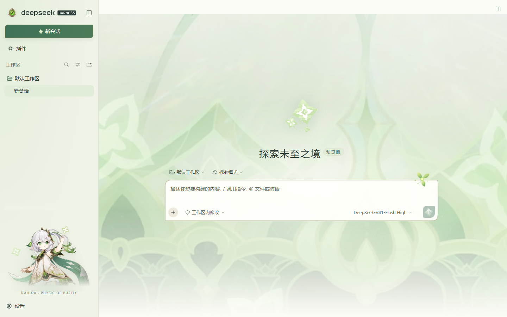

# Nahida · Shrine of Maya

[中文](README.md) · [Download](https://github.com/CH3SH-LC/dsh-theme-nahida/releases/latest) · [DeepSeek Harness](https://github.com/deepseek-ai/deepseek-harness)

An independent Nahida theme for **DeepSeek Harness (DSH)**, featuring Shrine of Maya namecard artwork, Seeds of Skandha, a Dendro Vision and a sidebar character illustration.



## Install

1. Download `local-dsh-theme-nahida-1.0.0.tgz` from [Releases](https://github.com/CH3SH-LC/dsh-theme-nahida/releases/latest). Do not extract it.
2. In DSH Desktop, open **Plugins → Add plugin**.
3. Paste the downloaded file's absolute path, install, then choose **Enable now**.

The theme activates immediately. Open **Settings → General → 纳西妲主题** to enable it or restore the original appearance. Light, dark and system appearance follow DSH's native appearance controls. Restoring the original is remembered across reloads.

You can also use `https://github.com/CH3SH-LC/dsh-theme-nahida` in the Add plugin dialog. The repository includes the prebuilt client, so installation needs no build scripts. Keep the directory in place when installing from a local source folder.

## Features and compatibility

- Aspect-preserving Shrine of Maya namecard background that adapts to window size.
- Original Seeds of Skandha artwork on the welcome screen and new-session button.
- Dendro Vision in both expanded and collapsed sidebars.
- Nahida illustration in the sidebar and a small Dendro seed ornament by the composer.
- Seven embedded assets, with no runtime image downloads.
- One theme, with light and dark appearances; no whale theme is included.

Visually verified on **DSH 0.2.0-rc.2 / Windows**, at widths of 480, 960 and 1440 pixels. Some decorations depend on that DSH version's DOM selectors. Other DSH releases and macOS/Linux desktop rendering have not been visually verified.

Disabling or uninstalling removes the plugin's styles and decorations. Other pets and themes have separate controls.

## Develop

Use Node.js 22 or newer. No third-party build dependencies are required.

```bash
git clone https://github.com/CH3SH-LC/dsh-theme-nahida.git
cd dsh-theme-nahida
npm run check
npm pack
```

Edit `theme.css`, `assets/` and `src/client/`; `build.mjs` produces the deterministic standalone client in `dist/`. Tests cover activation, native appearance, restore persistence, disposal and fallback behavior. CI runs on Windows/Linux with Node.js 22/24.

The package retains the name `@local/dsh-theme-nahida` for compatibility with existing local installations. Distribution is through GitHub, not the npm registry.

## License

Original code, CSS, build tools, tests and documentation are [MIT-licensed](LICENSE). **Third-party game artwork is excluded from the MIT license.** It remains the property of HoYoverse / miHoYo and the respective rights holders. See [ARTWORK.md](ARTWORK.md).

This is an unofficial fan project, not affiliated with DeepSeek or HoYoverse.
