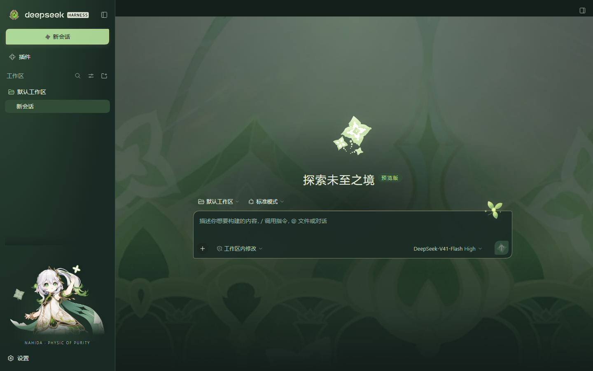
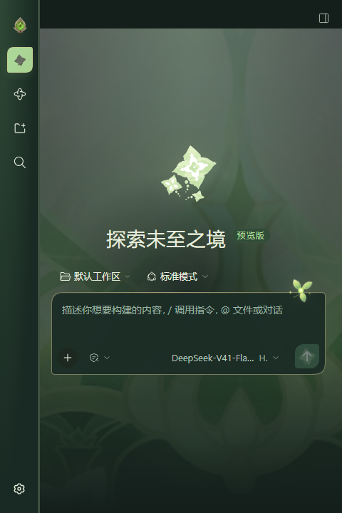

# 纳西妲 · 摩耶之殿

[English](README.en.md) · [下载安装包](https://github.com/CH3SH-LC/dsh-theme-nahida/releases/latest) · [DeepSeek Harness](https://github.com/deepseek-ai/deepseek-harness)

为 **DeepSeek Harness（DSH）** 制作的独立纳西妲主题插件。摩耶之殿、蕴种印、草元素神之眼与纳西妲立绘融入日常对话界面，浅色与深色跟随 DSH 的外观设置。


| 深色外观 | 窄窗口 |
| --- | --- |
|  |  |

## 安装

1. 从 [Releases](https://github.com/CH3SH-LC/dsh-theme-nahida/releases/latest) 下载 `local-dsh-theme-nahida-1.0.0.tgz`，**不用解压**。
2. 打开 DSH 桌面应用，进入 **插件 → 添加插件**。
3. 粘贴下载文件的完整路径，例如 `C:\Downloads\local-dsh-theme-nahida-1.0.0.tgz`。
4. 点击 **安装**，完成后点击 **立即启用**。

主题启用即生效。**设置 → 通用设置 → 纳西妲主题** 可以启用主题或恢复原版；上方原生 **外观** 设置负责浅色、深色和跟随系统。恢复原版的选择会保留到下次打开。

也可以在“添加插件”中使用仓库地址：

```text
https://github.com/CH3SH-LC/dsh-theme-nahida
```

仓库提交了预构建客户端，安装不需要额外的构建脚本。若使用源码文件夹安装，请填写文件夹的绝对路径，并保留该文件夹的位置。

## 设计

- **摩耶之殿背景**：采用游戏原始名片纹样，等比例覆盖可用画布，随窗口裁切。
- **蕴种印**：游戏原贴纸用于欢迎页和新建按钮；小按钮使用裁切后的主体符号。
- **草元素神之眼**：左上角标记，侧栏折叠时也保留。
- **纳西妲立绘**：放在左下角侧栏，内容区保留阅读空间。
- **草种子**：输入框边缘的小装饰。
- **离线素材**：7 个素材内嵌在客户端中，使用时不请求图片服务器。

此仓库仅包含纳西妲主题，不包含大肥鱼主题。

## 兼容性

验证环境为 **DSH 0.2.0-rc.2 / Windows**，覆盖 480、960、1440 像素窗口宽度、浅深色、原生外观切换、恢复原版与重新启用。

部分装饰选择器依赖该版本的 DSH 页面结构。升级 DSH 后若装饰位置变化，请在 [Issues](https://github.com/CH3SH-LC/dsh-theme-nahida/issues) 中提供 DSH 版本和问题描述。其他 DSH 版本及 macOS、Linux 桌面端尚未进行实际界面验证。源码构建与离线测试支持 Windows 和 Linux。

禁用或卸载本插件会移除主题样式与装饰。其他桌宠或主题插件拥有各自的设置；发生外观冲突时可先禁用其他主题排查。

## 开发

需要 Node.js 22 或更新版本，无第三方构建依赖。

```bash
git clone https://github.com/CH3SH-LC/dsh-theme-nahida.git
cd dsh-theme-nahida
npm run check
npm pack
```

`npm run check` 构建客户端、运行主题生命周期测试并检查发布内容。GitHub Actions 在 Windows / Linux 和 Node.js 22 / 24 上执行同样的检查。

```text
theme.css           浅深色配色与响应式布局
assets/             素材与小装饰
src/client/         主题生命周期、设置卡片与侧栏装饰
index.js            最小 Host 入口
cordis.patch.yml    DSH 插件声明
build.mjs           确定性构建器
dist/               可直接安装的客户端与构建清单
tests/              不需要 DSH 账号的离线检查
```

包名保留为 `@local/dsh-theme-nahida`，以兼容已有本地安装。当前通过 GitHub 发布，不是 npm registry 包。

## 许可与素材

原创代码、CSS、构建工具、测试和文档使用 [MIT 许可](LICENSE)。**原神游戏素材不属于 MIT 授权范围**，相关权利归 HoYoverse / miHoYo 等原权利人所有；详见 [素材来源与声明](ARTWORK.md)。

这是非官方同人主题，与 DeepSeek、HoYoverse 均无隶属关系。
